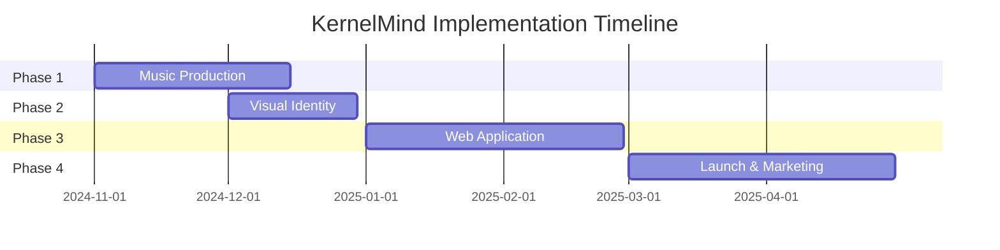

# 🗺️ Implementation Roadmap - KernelMind

# 🎯 Executive Summary
## 🎯 Executive Summary

The KernelMind project will be implemented in **4 distinct phases** over **8 months**, from music production to the complete interactive application launch.
## 🗓️ Overall Timeline

```mermaid
## 📅 Overall Timeline

```mermaid
    section Phase 1
    Music Production     :2024-11-01, 2024-12-15
    section Phase 2
    section Phase 2
        section Phase 2
    section Phase 3
    section Phase 3
    Web Application       :2025-01-01, 2025-02-28
    section Phase 4
    section Phase 4
        section Phase 4
```
## 🎵 PHASE 1: Music Production (6 weeks)

**Nov 2024 - Dez 2024**
### Week 1-2: Setup and Preparation
### Week 1-2: Setup & Preparation

**Objectives:**
**Objectives:**
...
```
### Week 3-4: Production of Base Tracks

**Objectives:**
**Objectives:**
...
```
### Week 5-6: Finalization and Master
### Week 5-6: Finalization & Mastering

**Objectives:**
**Objectives:**
...
```
## 🎨 PHASE 2: Visual Identity (4 weeks)

**Dec 2024**
### Week 1: Concept and Design

**Objectives:**
**Objectives:**
...
```
### Week 2: Album Artwork

**Objectives:**
**Objectives:**
...
```
### Week 3: Website and Digital

**Objectives:**
**Objectives:**
...
```
### Week 4: Visual Implementation

**Objectives:**
**Objectives:**
...
```
## 💻 PHASE 3: Application Development (8 weeks)

**Jan 2025 - Feb 2025**
### Week 1-2: Setup and Preparation

**Objectives:**
**Objectives:**
...
```
### Week 3-4: Core Functionality

**Objectives:**
**Objectives:**
...
```
### Week 5-6: Advanced Features

**Objectives:**
**Objectives:**
...
```
### Week 7-8: Testing and Polish

**Objectives:**
**Objectives:**
...
```
## 🚀 PHASE 4: Launch and Marketing (8 weeks)

**Mar 2025 - Apr 2025**
### Week 1-2: Pre-Launch
### Week 2: Album Artwork

**Objectives:**
**Objectives:**
### Week 3: Website and Digital
...
```
### Week 3-4: Soft Launch
### Week 4: Visual Implementation

**Objectives:**
**Objectives:**
...
```
### Week 5-6: Official Launch
### Week 1-2: Architecture and Setup

**Objectives:**
**Objectives:**
### Week 3-4: Core Functionality
...
```
### Week 7-8: Growth and Iteration
### Week 5-6: Advanced Features

**Objectives:**
**Objectives:**
### Week 7-8: Testing and Polish
...
```
## 💰 Estimated Budget

### Music Production
```
### Week 1-2: Pre-Launch
Producer.ai Pro (6 months): $300
DAW and plugins: $800
Mastering professional: $1,500
### Week 3-4: Soft Launch
Total: $2,600
```
### Design and Branding
### Week 5-6: Official Launch

```
Designer freelancer: $3,000
### Week 7-8: Growth and Iteration
Motion graphics: $1,500
Photography/assets: $500
Total: $5,000
```
### Development

```
Developer full-stack (2 months): $12,000
Web Audio specialist: $4,000
QA and testing: $2,000
Infrastructure (1 year): $1,200
Total: $19,200
```
### Marketing and Launch

```
PR and marketing: $5,000
Influencer partnerships: $2,000
Ads and promotion: $3,000
Conference presentations: $2,000
Total: $12,000
```
**Total Budget: $38,800**
---
## 👥 Team Structure

### Core Team (4 people)
```
Project Manager/Product Owner: 1
Music Producer/Audio Engineer: 1  
Full-Stack Developer: 1
UI/UX Designer: 1
```
### Consultants/Freelancers

```
Neuroscientist consultant
Marketing specialist
Community manager
QA engineer
```
## 📊 Success Metrics

### Objectives for Year 1
```
Users:
```
### Long-term Vision (3 years)

```
```
## 🔄 Post-Launch Iterations

### Version 2.0 Features
```
### Version 3.0 Vision

```
## ⚠️ Risks and Mitigation

### Technical Risks
**Risk:** Web Audio API limitations
**Mitigation:** Native app fallback, progressive enhancement
**Risk:** Binaural effectiveness varies per person
**Mitigation:** Customization options, A/B testing
### Market Risks

**Risk:** Saturation of the productivity app market
**Mitigation:** Focus on a specific niche (developers), unique value proposition
**Risk:** Slow adoption in the developer community
**Mitigation:** Open source components, community involvement
### Execution Risks

**Risk:** Timeline delays
**Mitigation:** Agile methodology, MVP approach
**Risk:** Budget overrun
**Mitigation:** Phased investment, milestone-based funding
## 📞 Immediate Next Steps

### This Week
1. ✅ Complete documentation
2. [ ] Setup Producer.ai environment
3. [ ] Create first track (Boot Kernel)
4. [ ] Define final team
### Next 2 Weeks  
1. [ ] Produce tracks 1-3
2. [ ] Refine visual identity
3. [ ] Start development setup
4. [ ] Establish initial partnerships
### Next Month
1. [ ] 50% of tracks produced
2. [ ] Website MVP online
3. [ ] Community building initiated
4. [ ] Beta testers recruited

*Roadmap updated regularly based on feedback and progress metrics*
# 🗺️ Implementation Roadmap - KernelMind

## 🎯 Executive Summary

The KernelMind project will be implemented in **4 distinct phases** over **8 months**, from music production to the complete interactive application launch.


## 📅 Overall Timeline




## 🎵 PHASE 1: Music Production (6 weeks)
**Nov 2024 - Dec 2024**

### Week 1-2: Setup & Preparation
**Objectives:**

**Deliverables:**

**Resources Required:**

### Week 3-4: Production of Base Tracks
**Objectives:**

**Tracks to Produce:**
1. ✅ Boot Kernel
2. ✅ Interrupt Handler  
3. ✅ Overclock
4. ✅ Kernel Panic
5. ✅ Trace Stack

**QA Checklist:**

### Week 5-6: Finalization & Mastering
**Objectives:**

**Remaining Tracks:**
6. ✅ Memory Leak
7. ✅ Deadlock
8. ✅ Garbage Collector
9. ✅ Reboot Sequence

**Entregáveis:**


## 🎨 PHASE 2: Visual Identity (4 weeks)
**Dec 2024**

### Week 1: Concept & Design
**Objectives:**

**Deliverables:**

### Week 2: Album Artwork
**Objectives:**

**Deliverables:**

### Week 3: Website & Digital
**Objectives:**

**Deliverables:**

### Week 4: Visual Implementation
**Objectives:**

**Deliverables:**


## 💻 PHASE 3: Application Development (8 weeks)
**Jan 2025 - Feb 2025**

### Week 1-2: Architecture & Setup
**Objectives:**

**Recommended Stack:**
```javascript
Frontend:

Backend:

Mobile:
```

### Week 3-4: Core Functionality
**Objectives:**

**Features:**

### Week 5-6: Advanced Features
**Objectives:**

**Integrations:**

### Week 7-8: Testing & Polish
**Objectives:**

**QA Process:**


## 🚀 PHASE 4: Launch & Marketing (8 weeks)
**Mar 2025 - Apr 2025**

### Week 1-2: Pre-Launch
**Objectives:**

**Distribution Platforms:**

### Week 3-4: Soft Launch
**Objectives:**

**Target Communities:**

### Week 5-6: Official Launch
**Objectives:**

**Marketing Channels:**

### Week 7-8: Growth & Iteration
**Objectives:**

**Key KPIs:**


## 💰 Budget Estimado

### Produção Musical
```
Producer.ai Pro (6 meses): $300
DAW e plugins: $800
Mastering profissional: $1,500
Total: $2,600
```

### Design e Branding
```
Designer freelancer: $3,000
Motion graphics: $1,500
Photography/assets: $500
Total: $5,000
```

### Desenvolvimento
```
Developer full-stack (2 meses): $12,000
Web Audio specialist: $4,000
QA e testing: $2,000
Infrastructure (1 ano): $1,200
Total: $19,200
```

### Marketing e Launch
```
PR e marketing: $5,000
Influencer partnerships: $2,000
Ads e promotion: $3,000
Conference presentations: $2,000
Total: $12,000
```

**Budget Total: $38,800**
---

## 👥 Team Structure

### Core Team (4 pessoas)
```
Project Manager/Product Owner: 1
Music Producer/Audio Engineer: 1  
Full-Stack Developer: 1
UI/UX Designer: 1
```

### Consultores/Freelancers
```
Neuroscientist consultant
Marketing specialist
Community manager
QA engineer
```
---

## 📊 Success Metrics

### Objectives for Year 1
```
- 5,000 downloads diretos

- 4.5+ rating nas app stores

- 3+ enterprise partnerships
```

### Long-term Vision (3 anos)
- Expansão internacional
```
---

## 🔄 Post-Launch Iterations

- [ ] Analytics dashboard avançado

- [ ] Multi-platform sync
---

## ⚠️ Riscos e Mitigação

### Riscos Técnicos
**Risco:** Web Audio API limitations
**Mitigação:** Native app fallback, progressive enhancement

**Risco:** Binaural effectiveness varies per person
**Mitigação:** Customization options, A/B testing

### Riscos de Mercado
**Risco:** Saturação do mercado de apps de produtividade
**Mitigação:** Foco em nicho específico (developers), unique value prop

**Risco:** Adoption slow em developer community
**Mitigação:** Open source components, community involvement

### Riscos de Execução
**Risco:** Timeline delays
**Mitigação:** Agile methodology, MVP approach

**Risco:** Budget overrun
**Mitigação:** Phased investment, milestone-based funding
---

## 📞 Next Steps Imediatos

### This Week
1. ✅ Complete documentation
2. [ ] Setup Producer.ai environment
3. [ ] Create first track (Boot Kernel)
4. [ ] Define final team

### Next 2 Weeks  
1. [ ] Produce tracks 1-3
2. [ ] Refine visual identity
3. [ ] Start development setup
4. [ ] Establish initial partnerships

### Next Month
1. [ ] 50% of tracks produced
2. [ ] Website MVP online
3. [ ] Community building initiated
4. [ ] Beta testers recruited
---

*Roadmap atualizado regularmente baseado em feedback e métricas de progresso*