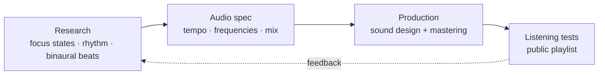

# KernelMind

### Neuroscience-informed sound design for developer focus

Ambient soundscapes, rhythm and binaural techniques designed to support deep work while you code.
Research base, audio specs and a public playlist — documented before any app is built.

---

## Table of Contents

- [Overview](#overview)
- [What is here](#what-is-here)
- [How a track is designed](#how-a-track-is-designed)
- [Documentation](#documentation)
- [Scientific responsibility](#scientific-responsibility)
- [Current status](#current-status)

---

## Overview

**KernelMind** started from a DJ's question applied to a programmer's day: *can sound be engineered to help you
stay in flow, the way a set keeps a dance floor moving?* The project collects the research, writes down the
audio rules and publishes the music first, so the idea can be heard and judged before any app exists.

It is built for:

- developers and other deep-work people who code with headphones on;
- producers interested in psychoacoustics and binaural techniques;
- contributors who want a documented concept to build a player on.

---

## What is here

| Area | Contents |
|---|---|
| **Music** | Concept tracks on the [public playlist](https://www.youtube.com/playlist?list=PLEHQ0mK4Ozby9VBG_rj7VJnqxjaHbGOzI) |
| **Research** | Neuroscience and psychoacoustics notes with references |
| **Audio engineering** | Delivery format, mix specs, binaural frequencies per track, processing chain |
| **Product** | Phased roadmap: music, visual identity, then player and integrations |
| **Brand** | Visual identity guide |
| **Production** | Prompt library used to explore sound ideas |

---

## How a track is designed

---

## Documentation

| Document | Purpose |
|---|---|
| [Scientific Research](SCIENTIFIC_RESEARCH.md) | Research context and references |
| [Technical Specifications](TECHNICAL_SPECIFICATIONS.md) | Audio parameters, binaural frequencies, processing chain |
| [Implementation Roadmap](IMPLEMENTATION_ROADMAP.md) | Delivery phases and timeline |
| [Project Status](PROJECT_STATUS.md) | What exists, what is planned, what is not claimed |
| [Visual Identity](VISUAL_IDENTITY_GUIDE.md) | Brand and interface direction |
| [Producer Prompts](Producer-AI-Prompts.md) | Sound-production concepts |
| [Complete Report](COMPLETE_REPORT_EN.md) | The full write-up in one file |
| [FAQ](FAQ.md) | Scope and common questions |

---

## Scientific responsibility

KernelMind makes **no medical or therapeutic claims**. Research on binaural beats and productivity is mixed and
individual responses vary. Keep the volume at safe levels. This is a creative experiment in focus support.

Contributions: [CONTRIBUTING.md](CONTRIBUTING.md) · [CODE_OF_CONDUCT.md](CODE_OF_CONDUCT.md) · [SECURITY.md](SECURITY.md)

---

## Current status

| | |
|---|---|
| **Available** | Playlist, research notes, audio specs, roadmap, visual identity |
| **Planned** | Web player, focus-session controls, desktop/mobile apps, optional IDE integrations |
| **Not claimed** | A released app, clinical validation, guaranteed productivity gains |

---

**Need something built, secured or kept online?** → [contato@n3xus.dev](mailto:contato@n3xus.dev) · [n3xus.dev](https://n3xus.dev)

MIT © Thiago "Samurai" Rangel · [N3XUS](https://n3xus.dev)

